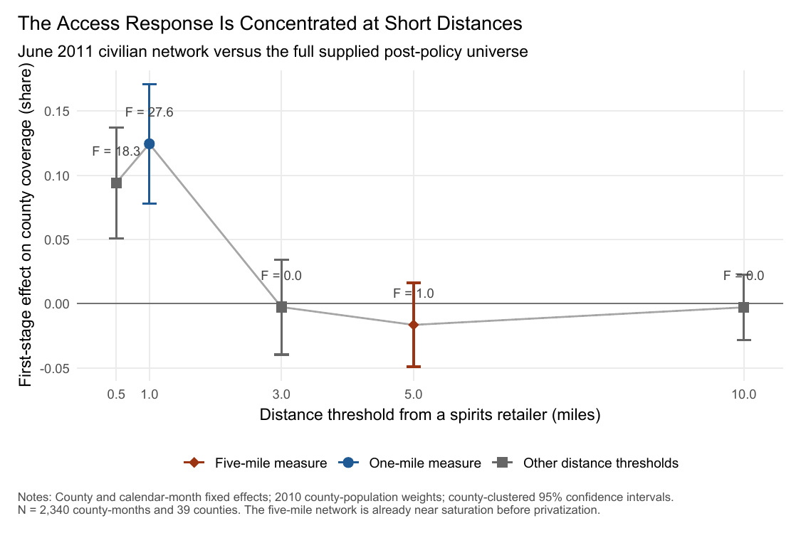

---
format:
  html:
    toc: false
    anchor-sections: false
    title-block: false
    title-block-banner: false
---

::: {.home-hero}
::: {.site-hero-text}

David Hall

I am an applied microeconomist and data scientist studying health, risky behavior, and public policy. My research examines how market access and public institutions shape substance use, treatment, and health outcomes. I also serve on Oregon's [Behavioral Health Resource Network Oversight and Accountability Council](https://www.oregon.gov/oha/HSD/AMH/Pages/OAC.aspx).

[Curriculum vitae](cv.qmd){.home-inline-link}
:::

::: {.site-hero-image}

<a class="home-inline-link" href="https://www.linkedin.com/in/david-hall-58a5b6125/" target="_blank" rel="noopener">LinkedIn</a>
<a class="home-inline-link" href="mailto:dhall7@uoregon.edu">Email</a>

:::
:::

::: {.job-market-panel}

2026-2027 Job Market

## Pour Decisions: Alcohol Privatization and Birth Outcomes

Washington's Initiative 1183 substantially expanded spirits access through grocery and big-box stores. I study how that change affected birth outcomes and what the results imply for alcohol-tax design aimed at limiting health harms.

Working paper · Available upon request

{.job-market-figure}

<strong>Abstract.</strong> Alcohol-market liberalization can generate a large aggregate demand response without producing an equally large change in a particular externality if the behavioral response occurs outside the population relevant to that harm. I study Washington's Initiative 1183, which privatized spirits retailing in June 2012 and expanded entry by grocery and big-box stores. NielsenIQ Homescan data indicate that recorded conventional-spirits beverage volume increased by 71.4% following privatization. Complete ethanol quantities are not validated because product-level alcohol-content coverage is insufficient. These data do not identify consumers or prenatal alcohol exposure. Using restricted-use vital statistics and repeated-cross-section synthetic difference-in-differences, I estimate declines of 10.28 grams in average birth weight and increases of 0.274 and 0.357 percentage points in low birth weight and small-for-gestational-age births. These estimates are not unusually large relative to complete placebo-state refits, and the broader fetal-growth outcome family is not jointly unusual. Pregnancy accounting and maternal composition reveal no large, coherent shift in the observed birth pool. Within Washington, predetermined grocery infrastructure strongly predicts expansions in one-mile spirits access, but the associated birth-health estimates are mixed and sensitive to identification diagnostics. The results show that aggregate alcohol-demand responses alone are insufficient to predict a specific downstream harm: product substitution and the incidence of the behavioral response determine whether market liberalization reaches the relevant population.

:::
